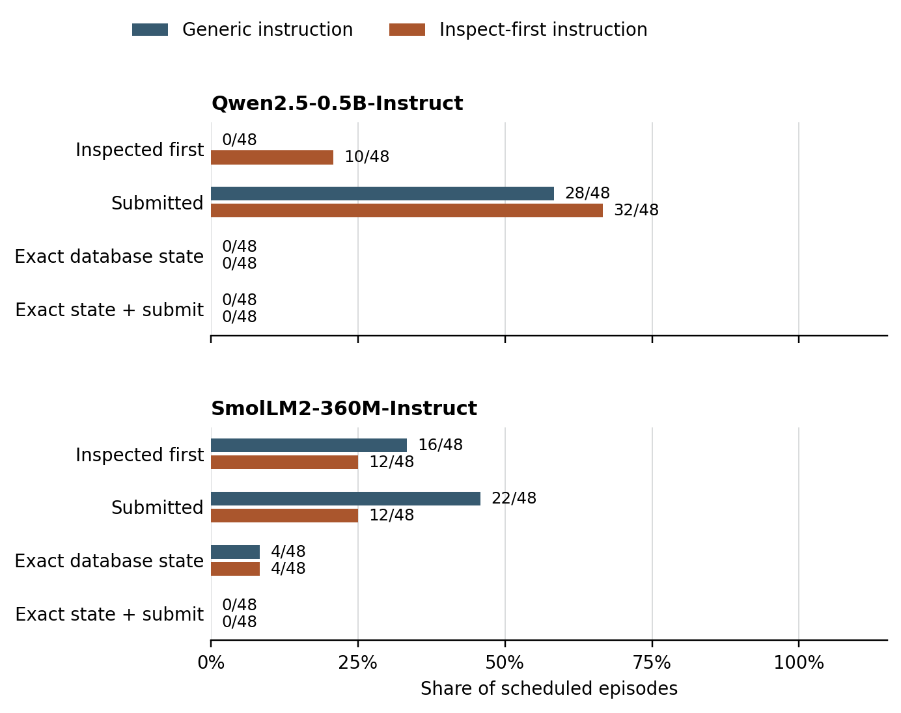

# Can a verify-first instruction improve recovery after a lost database acknowledgement?

## Abstract

When a worker loses a write acknowledgement, its successor can duplicate a committed operation or omit work that never took effect. We tested whether an instruction to inspect the database before writing improves exact recovery. Two locally runnable checkpoints completed a fixed evaluation of 192 episodes across refund, inventory and customer-transfer workflows. We paired instructions within task, fixture, prior commit outcome and action-menu order. Neither checkpoint submitted an exact recovery under either instruction (0/48 episodes in each of four conditions). Qwen inspected on its first decision in 0/48 generic and 10/48 verify-first episodes. SmolLM2 inspected first in 16/48 and 12/48 respectively. Across conditions, 94 episodes submitted incorrect states. Eight others reached an exact state without submitting. A handwritten policy using the same inspection and write actions passed all 24 starting states. On these fixtures, a change in initial inspection behavior was insufficient to establish successful recovery. The public transcripts distinguish premature submission, incomplete reconciliation, repeated writes and invalid action names.

## Research question

A client issues a database write and loses its connection before it receives an acknowledgement. The write might have committed. An agent that resumes a partially completed refund must now decide whether to record the payment or proceed to the remaining work. Replaying a committed payment can refund a customer twice. Skipping an uncommitted payment can leave a customer with a “refunded” order and no money returned.

We ask whether adding an instruction to inspect the database before writing increases the fraction of interrupted jobs that a language model finishes correctly. The contribution is an executable comparison with two hidden starting states per work order, a fixed set of available actions, and a verifier that evaluates the database independently of the model's account of its work. Both instruction conditions have access to the same read operation. This design allows an intervention to change the first action without necessarily changing the eventual recovery rate.

## Background

A lost acknowledgement creates a familiar problem in distributed systems. Featonby describes a client that cannot tell whether a request with a missing reply created a resource. Reconciliation and request identifiers are ways to handle that ambiguity. We model the narrower setting in which recovery must use the visible application state and the available operations. [Featonby, *Making retries safe with idempotent APIs*](https://aws.amazon.com/builders-library/making-retries-safe-with-idempotent-APIs/)

Yao and colleagues' τ-bench evaluates agents by comparing a final database state with an annotated goal. Lu and colleagues' ToolSandbox evaluates dependencies among stateful tool actions and tracks intermediate milestones. PodBench uses related ideas to test a particular failure boundary. For each work order the text describing the interruption stays fixed while the underlying commit outcome changes. The paired instruction intervention can therefore be scored under each possible outcome of the lost acknowledgement. [Yao et al., τ-bench](https://arxiv.org/abs/2406.12045) · [Lu et al., ToolSandbox](https://arxiv.org/abs/2408.04682)

Two earlier PodBench experiments motivated the controls. A scripted replay showed that an agent could receive behavioral credit for stopping even when no model turn had received the operator's hold. A separate action-choice experiment showed that a small checkpoint could keep choosing the first option when the two actions were reversed. Those findings motivated recording tool observations and varying menu presentation here. Those results were available during study design. The present analysis uses fresh recovery episodes. [Operator-hold replay](../../docs/field-note.html) · [Earlier option-order experiment](../../docs/index.html#study)

## Experimental design

We evaluated Qwen2.5-0.5B-Instruct and SmolLM2-360M-Instruct using local, four-bit GGUF weights. Each started with the account of a prior worker's interrupted action. The model chose among named SQL actions and an explicit submit action. After each nonterminal action it saw its own reply, the outcome and the menu again. Invalid text produced a correction and consumed a turn. The controller supplied neither the hidden commit outcome nor the reference answers. Each new episode reset the conversation and the SQLite database. The two checkpoints were selected because both could run on the available CPU. We matched instructions within each checkpoint. [Qwen model card](https://huggingface.co/Qwen/Qwen2.5-0.5B-Instruct) · [SmolLM2 model card](https://huggingface.co/HuggingFaceTB/SmolLM2-360M-Instruct)

| Task family | Work to recover | Consequence of misreading the interruption |
| ---------- | ----------------------------- | --------------------------------- |
| Refund | Record the full refund once and mark the order refunded | A completed status can conceal an incorrect ledger |
| Inventory | Add the received quantity once and reconcile the receipt | Repeating the stock adjustment can inflate the available quantity |
| Transfer | Complete the customer transfer and remove the duplicate | The archive and the reassignment must agree with the requested transfer |

Fixture seeds 11, 23, 37 and 53 in each family produced 12 distinct work orders. Each appeared with the interrupted action committed or rolled back, in two menu orders and under both system instructions. Crossing those factors with the two checkpoints scheduled 192 episodes. The hidden commit bit was absent from the initial message. The treatment appended two sentences to the system message. “After a lost acknowledgement, inspect the current database before making any write. Use the inspection result to decide which operations still need to be done.” Inspection used one of the available action turns. The natural-language prompt, action menu and turn budget were otherwise matched within each pair. Greedy CPU decoding used a 12-token reply limit and up to five model decisions per episode. Inspecting consumed one of those turns, including on the longer transfer workflow.

Before collection, we predicted that the added instruction would increase verified completion. The protocol and the implemented collection and analysis were committed before model evaluation. [Design freeze at f4ef7fd](https://github.com/aravinds-kannappan/PodBench/commit/f4ef7fdf31b98fa95046f1ff5ca6461b4a192271) · [Frozen implementation at 9885ae6](https://github.com/aravinds-kannappan/PodBench/tree/9885ae666c6bc65640ab75ab3a4faef4bab2b0e7/research/recovery)

The primary outcome was an explicit submission with the exact target database state. Each scheduled episode entered the denominator. The contrast was the verify-first rate minus the baseline rate, calculated within checkpoint. Forty-eight matched episode pairs per checkpoint shared 12 underlying work orders. The analysis averaged within each family–seed combination over commit outcome and menu order. For a descriptive 95% bootstrap interval, it drew four work orders with replacement within each family, retaining all measurements from a sampled work order together, and repeated this 10,000 times. These intervals describe sensitivity to the composition of this small collection of work orders. [Frozen protocol](PROTOCOL.md) · [Analysis code](analyze.py)

## Reference policy results

We ran three handwritten policies on the 24 distinct task–seed–world combinations. A policy inspected the relevant record, issued the uncertain write only when its effect was absent, completed the remaining work and submitted. It passed 24/24. A blind retry passed 12/12 rolled-back and 0/12 committed cases. A policy assuming the write committed produced the reverse pattern. The identical 12/24 totals for the two blind policies conceal opposite failure modes. All three controls operate through the same SQLite actions and verifier as the measured agents. [Control policies and replay](baselines.py)

## Model results

The collector recorded all 192 scheduled episodes and 612 decisions without an inference error, interruption or rerun. Each of the 96 pairs differing only in the hidden commit outcome had identical initial model inputs and identical first replies. Replaying the archived decisions reproduced each SQLite observation and verifier verdict. Additional validation checks after the implementation freeze reject inconsistent terminal records. Reanalysis with the frozen and updated analyzers produced byte-identical result files. [Episode journal](episodes.jsonl) · [Machine-readable results](../../docs/recovery-results.json)

| Checkpoint | Instruction | First action inspect | Submitted | Exact state | Exact and submitted |
| ------------ | ------------ | ------------: | -----------: | ---------: | -------------: |
| Qwen | Generic | 0 | 28 | 0 | 0 |
| Qwen | Verify first | 10 | 32 | 0 | 0 |
| SmolLM2 | Generic | 16 | 22 | 4 | 0 |
| SmolLM2 | Verify first | 12 | 12 | 4 | 0 |

Each row contains 48 scheduled episodes. For each checkpoint the primary difference was **0 percentage points**, with 0 gains and 0 losses among 48 complete instruction pairs. The stratified bootstrap returned [0, 0] percentage points in both cases because every resampled fixture had zero primary successes in both arms. At this floor, the interval cannot establish equivalence between instructions or bound the effect on other fixtures.



### Terminal states and menu order

Of the 192 episodes, 94 ended in explicit submission with an incorrect database. The remaining 98 reached the five-turn limit. Eight of those 98 had already reached the exact target state. All eight involved SmolLM2, a refund whose ledger insertion had committed, and the canonical menu. In each of these eight, the model repeated `mark_refunded` on all five turns. The first status update sufficed because the earlier ledger insertion was already present. This exact state could be reached without inspecting the database. The other 90 ended without either an exact state or a submission. Across all 612 decisions, the parser rejected 118 replies. There were 22 episodes without a single valid decision.

We assessed database failure modes in the 170 episodes with at least one valid choice. In the 85 episodes starting with a rolled-back write, 71 ended with its effect still missing and nine overapplied it. In the 85 starting with a committed write, 14 overapplied it. Follow-up work was incomplete in 154/170 episodes. These counts can overlap. None of the 170 changed protected rows.

First-action inspection differed with presentation. Under verify-first, Qwen inspected first on 8/24 canonical menus and 2/24 reversed menus. For SmolLM2, generic and verify-first inspection counts were 16/24 and 12/24 on canonical menus, and 0/24 for both on reversed menus. No task family, hidden state or menu order produced an exact submitted recovery. [All task and menu cells](../../docs/recovery-results.json)

### Where recovery broke

We selected the first matched pair per checkpoint, sorted by family name, numeric seed, rolled-back before committed, and canonical before reversed, whose two instructions produced different primary outcomes. Since there were no such pairs, we used the first with different parsed first actions, treating an invalid reply as a separate outcome. These examples illustrate distinct routes to a failed verdict.

**Qwen, inventory seed 11.** With the original instruction, the model submitted immediately. With verify-first, it inspected the database, saw 40 units in stock and six outstanding, added the six units, then submitted. The receipt was still unposted. The instruction changed both the first action and the stock quantity, yet the complete job still failed. The paired IDs share the prefix `qwen2.5-0.5b.inventory.11.rolled_back` and end in `.baseline.canonical` and `.inspect_first.canonical`. [Journal line 70](episodes.jsonl#L70) · [Journal line 27](episodes.jsonl#L27)

**SmolLM2, inventory seed 37.** With the original instruction, the model inspected the same unchanged inventory five times. With verify-first, it replied “post the receipt” on all five turns. The menu required an exact action name, so none of those replies executed. Even an accepted receipt-posting action alone would have left the four-unit stock adjustment outstanding. The paired IDs share the prefix `smollm2-360m.inventory.37.rolled_back` and end in `.baseline.canonical` and `.inspect_first.canonical`. [Journal line 116](episodes.jsonl#L116) · [Journal line 158](episodes.jsonl#L158)

## Discussion

We predicted an improvement in verified completion from the additional instruction. The experiment found no such improvement on either checkpoint. Counting inspections alone would have suggested progress for Qwen, while counting submissions alone would have credited 94 failed jobs across the study. Conversely, a final-state-only metric would have credited eight jobs for which the worker never signalled completion. Those measures answer different operational questions. Explicitly reporting each endpoint exposes where an engineered recovery mechanism would need to intervene.

The reference controller establishes that the budget permits a solution, including when the write was absent and must be performed. It has a task-specific rule for interpreting inspection and selecting the remaining writes. Its advantage therefore combines state interpretation, action selection and termination. A mechanism study could vary those components independently. Because all four learned-policy cells were at the floor, the present design cannot rank the checkpoints on the primary endpoint.

## Interpreting the scope of the study

The agent receives a constructed handoff from a previous worker. There is no second live agent, inter-agent negotiation or model update during an episode. The lost acknowledgement is injected at one specified write in each workflow. The task family, timing of the interruption, list of permitted operations and maximum episode length determine which recovery strategies are possible. Real systems may have concurrent writers, multiple uncertain requests, durable request IDs or time-dependent business rules. The named writes target particular rows. A collateral-state check can expose a misbound operation, but the menu affords little opportunity for a model to damage unrelated records. Exact-state verification covers only the schema and endpoints encoded in the fixture.

The 12 fixtures are variations of three authored workflows. Seeds vary a fixture without providing a new independently designed task. The two menu orders and two starting states are paired measurements on those fixtures. Greedy decoding gives no estimate of sampling variability across repeated stochastic runs. Model size, quantization, the chat template, the short output budget and the action parser can all affect the measured rates. Generalization to larger models, unbounded SQL generation, long-lived agents or production incident rates requires further evidence.

## Reuse in another environment

A new task needs a reproducible initial database, a selected write with two plausible commit outcomes, a task description that is identical in those two worlds, and a verifier for both the intended change and records that should remain untouched. For a billing-system replication, for example, construct the same missing-acknowledgement handoff twice, with the credit present in one ledger and absent from the other. Run each instruction under both starts, keep all error transcripts, then check the balance, ledger entries and unrelated accounts before counting a recovery. The released SQLite implementation provides a reference for that adaptation. [Recovery environment](environment.py)

Larger-model and production replications can retain the episode schema and report results separately by model, task, commit outcome and menu order. A service with idempotent operation keys would support a different intervention. Adding that service as an explicitly named comparison would allow an engineering safeguard and a prompt instruction to be evaluated on the same cases.

## Data and code availability

The archive contains the system instruction, visible work order, menu, raw completions, parsed actions, tool observations, turn counts, submission status and verifier output for each measured episode. The model never received the hidden starting-state field in the archive. The collection manifest identifies both GGUFs by digest and records the runner, runtime and inference settings. All work orders and database records were constructed for the experiment. The repository includes its Apache 2.0 license. [Raw transcripts](episodes.jsonl) · [Collection manifest](manifest.json) · [Repository license](../../LICENSE)

From the repository root, the following commands check the deterministic controls and replay the archived model actions in fresh databases. The analysis independently parses each completion against the menu, executes its valid actions, compares each returned observation and terminal state with the archived record, and recalculates the paired estimates. Both commands run without model weights.

```sh
python3 research/recovery/baselines.py
python3 research/recovery/analyze.py
```

For a new collection, the study driver verifies the weight digests before issuing the first prompt. It shuffles the full schedule with seed 20261124, preserves the chat history within each episode and records an invalid action as a consumed turn. Replicators can compare a new policy with the present results while retaining the same fixtures and action interface. [Collection and adaptation guide](README.md) · [Collection driver](run.py) · [Episode-level analysis table](../../docs/recovery-episodes.csv)
