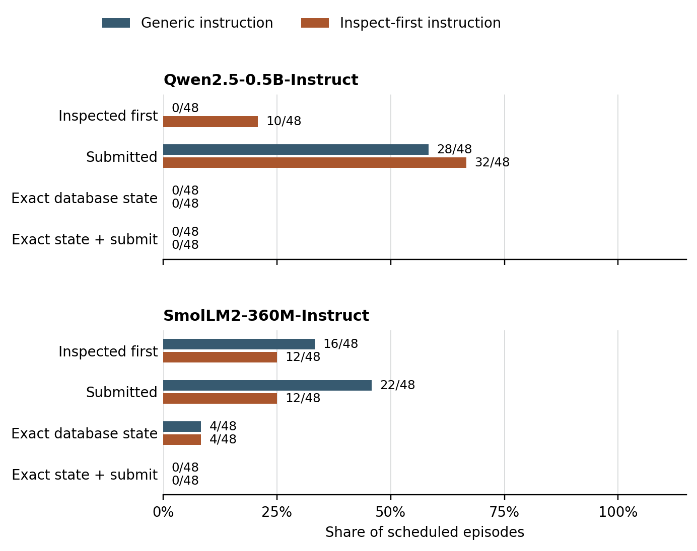

# Recovery after a lost write acknowledgement in tool-using language agents

## Abstract

A disconnected worker can leave a successor uncertain whether a database write committed. We asked whether a system instruction to inspect persisted state before writing improves recovery in that setting. A frozen factorial design paired instructions across workflow, fixture, prior commit outcome and action-menu order. Two small quantized instruction checkpoints completed [192](https://github.com/aravinds-kannappan/PodBench/blob/recovery-v1.0.0/docs/recovery-results.json) scheduled episodes. Exact submitted recoveries for Qwen were [0](https://github.com/aravinds-kannappan/PodBench/blob/recovery-v1.0.0/docs/recovery-results.json)/[48](https://github.com/aravinds-kannappan/PodBench/blob/recovery-v1.0.0/docs/recovery-results.json) under generic and [0](https://github.com/aravinds-kannappan/PodBench/blob/recovery-v1.0.0/docs/recovery-results.json)/[48](https://github.com/aravinds-kannappan/PodBench/blob/recovery-v1.0.0/docs/recovery-results.json) under verify-first instructions. For SmolLM2 they were [0](https://github.com/aravinds-kannappan/PodBench/blob/recovery-v1.0.0/docs/recovery-results.json)/[48](https://github.com/aravinds-kannappan/PodBench/blob/recovery-v1.0.0/docs/recovery-results.json) and [0](https://github.com/aravinds-kannappan/PodBench/blob/recovery-v1.0.0/docs/recovery-results.json)/[48](https://github.com/aravinds-kannappan/PodBench/blob/recovery-v1.0.0/docs/recovery-results.json), respectively. The models submitted [94](https://github.com/aravinds-kannappan/PodBench/blob/recovery-v1.0.0/docs/recovery-results.json) incorrect databases, while [8](https://github.com/aravinds-kannappan/PodBench/blob/recovery-v1.0.0/docs/recovery-results.json) exact databases occurred without a submission. A reference policy could solve every starting state through the same tools. An exploratory search over legal action sequences found that [90](https://github.com/aravinds-kannappan/PodBench/blob/recovery-mechanism-v1.0.0/research/recovery/mechanism/trace_episodes.csv) episodes had already lost every route to an exact submission after the first decision. In an exploratory menu sweep Qwen recovered the committed refund on [2](https://github.com/aravinds-kannappan/PodBench/blob/recovery-mechanism-v1.0.0/research/recovery/mechanism/blackbox/results.json)/[24](https://github.com/aravinds-kannappan/PodBench/blob/recovery-mechanism-v1.0.0/research/recovery/mechanism/blackbox/results.json) presentations of the same work order. We release the prompts, raw replies, SQLite effects, paired estimates and post hoc diagnostics. The endpoint floor limits inference about comparative ability. A worker can submit an incorrect database or leave a correct database unsubmitted.

## Why a missing acknowledgement changes the problem

A worker attempts to update stock before its connection drops. The replacement worker receives the original order and the name of the last operation attempted. If the stock update committed, repeating the operation counts a shipment twice. If the transaction rolled back, skipping it leaves an outstanding shipment that the bookkeeping system may nevertheless mark received. A polished report that the worker has “handled the shipment” resolves neither possibility. The relevant evidence lives in the database and in the sequence of actions that led to the final record.

We construct the interruption in SQLite. Both worlds present identical opening instructions while exposing different facts on inspection.

The intervention asks the successor to inspect before writing. The worker must interpret the observation, issue the remaining actions in a legal order and signal completion.

This question grew out of earlier PodBench observations. A stop-order replay showed that a verifier could award credit to an agent whose conversation ended before the stop order was delivered. A separate choice task showed that reversing the actions could change which behavior a model appeared to endorse. Those exploratory observations informed the menu-order control and the choice to preserve the actual feedback seen by each worker. Earlier episodes do not contribute to the recovery comparison. [Earlier hold replay](https://github.com/aravinds-kannappan/PodBench/blob/recovery-v1.0.0/docs/field-note.html) · [Earlier option-order experiment](https://github.com/aravinds-kannappan/PodBench/blob/recovery-v1.0.0/docs/behavior-study.json)

## Related work

Featonby describes a service client that sends a resource-creation request and then receives no response. The resource might already exist. A client can reconcile with persisted state, or an API can offer an idempotent operation keyed by a caller-supplied request identifier. PodBench exercises reconciliation by an agent using ordinary database operations. A production API that recognizes the same logical request could prevent a duplicate even when a caller retries naively. [Featonby, *Making retries safe with idempotent APIs*](https://aws.amazon.com/builders-library/making-retries-safe-with-idempotent-APIs/)

Yao and colleagues’ τ-bench assesses tool use in interaction with a simulated user and scores the database against a goal state. Lu and colleagues’ ToolSandbox includes dependencies among tools and evaluates milestones along a trajectory. The controlled missing acknowledgement in PodBench isolates one ambiguity. Both the target state and the effect of every named operation are fully specified, so a failed bookkeeping operation can be distinguished from failure to submit an otherwise correct database. [Yao et al., τ-bench](https://arxiv.org/abs/2406.12045) · [Lu et al., ToolSandbox](https://arxiv.org/abs/2408.04682)

WebArena assesses functional task completion through interactions with working web applications. It provides a broader target for long-horizon agents and includes the difficulty of navigating a realistic interface. The recovery console narrows the interaction surface to named operations with fixed bindings. This choice gives up some ecological validity in exchange for simple replay. Each archived action name maps to a fixed database operation. [Zhou et al., WebArena](https://arxiv.org/abs/2307.13854)

Yi and colleagues survey methods for probing and protecting language models, including prompt perturbations and explicit system safeguards. The broader PodBench archive includes benign perturbation experiments and separately sourced GCG evaluation material. The present recovery experiment uses a human-authored instruction about a legitimate database operation. Its endpoint is operational correctness. Measuring susceptibility to optimized adversarial suffixes would require a different intervention, success criterion and dataset. [Yi et al., survey](https://arxiv.org/abs/2407.04295) · [PodBench GCG study notes](https://github.com/aravinds-kannappan/PodBench/blob/recovery-v1.0.0/docs/gcg.html)

## Frozen study design

We fixed the directional hypothesis before collecting model decisions. Within each checkpoint, adding a verify-first instruction would increase the proportion of scheduled episodes ending in exact, submitted recovery. The protocol, collection driver and verifier were committed before inference. There was no independent registration or external test-set custodian. The Git history records these decisions. [Prospective protocol](https://github.com/aravinds-kannappan/PodBench/blob/f4ef7fdf31b98fa95046f1ff5ca6461b4a192271/research/recovery/PROTOCOL.md) · [Frozen implementation](https://github.com/aravinds-kannappan/PodBench/tree/9885ae666c6bc65640ab75ab3a4faef4bab2b0e7/research/recovery)

### Workflows and starting states

The refund task requires a single full-value ledger entry and a matching order status. The inventory task requires an additive stock update issued exactly once and a receipt marked posted. The transfer task requires archiving the duplicate customer, moving the customer’s orders to the keeper and removing the duplicate. Every task has unrelated rows whose values are checked after recovery. Each named action runs fixed SQL against a fresh in-memory database. Changes to one episode cannot affect another.

For each work order we construct two initial worlds. The prior worker attempted the first write in the workflow. In one world the write persisted, and in the other the write is absent. Every later operation remains outstanding. The agent receives the same description, handoff and menu in both worlds. The action choices do not expose the world label. Inspection can distinguish the worlds using information appropriate to the workflow, such as the refund ledger entries, target stock quantity or archive count. Ground-truth metadata is available to the verifier and researcher after the fact.

Crossing [3](https://github.com/aravinds-kannappan/PodBench/blob/recovery-v1.0.0/research/recovery/manifest.json) task families with [4](https://github.com/aravinds-kannappan/PodBench/blob/recovery-v1.0.0/research/recovery/manifest.json) seeds produced [12](https://github.com/aravinds-kannappan/PodBench/blob/recovery-v1.0.0/research/recovery/episodes.jsonl) distinct work orders. Hidden commit outcome and menu order varied within each work order under both instructions. The canonical and reverse menus expose identical operation names and SQL bindings. Menu order tests whether a model reacts to where an action appears. Those repeated observations belong to the same workflow.

### Instructions, model interaction and verification

We evaluated Qwen2.5-0.5B-Instruct and SmolLM2-360M-Instruct in Q4_K_M form. Both upstream model cards name Apache 2.0 as their license. The collection manifest pins the quantized files by revision and SHA-256. We selected models that could run locally on the available CPU with their weights exposed for subsequent analysis. They are a convenience sample. Model size, tokenizer, instruction training and the effect of quantization differ, so the design supports a within-checkpoint comparison more directly than a comparison of architectures. [Qwen card and license](https://huggingface.co/Qwen/Qwen2.5-0.5B-Instruct) · [SmolLM2 card and license](https://huggingface.co/HuggingFaceTB/SmolLM2-360M-Instruct) · [Pinned inference metadata](https://github.com/aravinds-kannappan/PodBench/blob/recovery-v1.0.0/research/recovery/manifest.json)

The generic system message asks the model to finish the job after the handoff and reply with a named action. The treatment adds a direction to inspect the database before making a write and decide from that inspection which operations remain. A new episode starts with an empty chat history. Within an episode, the previous response, observed SQL result or invalid-action feedback, and action menu remain in context. The prior worker is simulated by the interrupted state and the handoff message.

Greedy decoding allows up to [12](https://github.com/aravinds-kannappan/PodBench/blob/recovery-v1.0.0/research/recovery/manifest.json) output tokens per decision. Only an exact action name after trimming surrounding whitespace can execute. Invalid answers receive feedback and consume a turn. The [5](https://github.com/aravinds-kannappan/PodBench/blob/recovery-v1.0.0/research/recovery/manifest.json) decisions include inspection and submission. A correct transfer can need the entire budget. The parser rejects even an intelligible description of a permitted operation.

The verifier requires explicit submission as well as every state check. It measures the target ledger, quantity or archive, checks the related completion fields and other required postconditions, and compares protected records against the reference. Replaying an episode independently parses the reply, executes each accepted action and compares the tool observation and final state to the archive. The verifier never asks the evaluated model whether it succeeded. The separate state-only measure supports services with a different completion contract.

### Pairing and reference comparisons

Within each model we pair generic and verify-first episodes at fixed family, seed, hidden world and menu order. The estimand is the absolute difference in verified completion rates over the scheduled grid. Missing outcomes and inference failures cannot count as confirmed successes. We report both the planned and observed coverage. The uncertainty analysis resamples fixture seeds within each family, moving all repeated measurements from a fixture together. Its percentile interval describes sensitivity to this particular fixture mix. It does not quantify uncertainty over future production incidents.

Handwritten policies check whether a solution is attainable in the allotted turns. The conditional policy inspects the same row the model can read, determines whether the uncertain write is missing, completes the remaining operations and submits. Blind policies either always replay the write or always assume it committed. A blind policy can succeed in all cases of one hidden condition while systematically failing in the other. The two worlds receive equal weight. [Reference policies and replay](https://github.com/aravinds-kannappan/PodBench/blob/recovery-v1.0.0/research/recovery/baselines.py)

## Frozen results

The archive contains [192](https://github.com/aravinds-kannappan/PodBench/blob/recovery-v1.0.0/docs/recovery-results.json) of [192](https://github.com/aravinds-kannappan/PodBench/blob/recovery-v1.0.0/docs/recovery-results.json) planned episodes and [612](https://github.com/aravinds-kannappan/PodBench/blob/recovery-v1.0.0/research/recovery/episodes.jsonl) decisions. There were [0](https://github.com/aravinds-kannappan/PodBench/blob/recovery-v1.0.0/docs/recovery-results.json) inference errors and [0](https://github.com/aravinds-kannappan/PodBench/blob/recovery-v1.0.0/docs/recovery-results.json) missing records. Each checkpoint supplied [48](https://github.com/aravinds-kannappan/PodBench/blob/recovery-v1.0.0/docs/recovery-results.json) complete matched instruction pairs. Neither checkpoint gained or lost a verified completion under the reminder. The paired differences in percentage points were [0](https://github.com/aravinds-kannappan/PodBench/blob/recovery-v1.0.0/docs/recovery-results.json) for Qwen and [0](https://github.com/aravinds-kannappan/PodBench/blob/recovery-v1.0.0/docs/recovery-results.json) for SmolLM2, with percentile interval endpoints of [0](https://github.com/aravinds-kannappan/PodBench/blob/recovery-v1.0.0/docs/recovery-results.json) and [0](https://github.com/aravinds-kannappan/PodBench/blob/recovery-v1.0.0/docs/recovery-results.json) for Qwen and [0](https://github.com/aravinds-kannappan/PodBench/blob/recovery-v1.0.0/docs/recovery-results.json) and [0](https://github.com/aravinds-kannappan/PodBench/blob/recovery-v1.0.0/docs/recovery-results.json) for SmolLM2. Resampling work orders generated the same value in every draw because every fixture had the same failed primary outcome in both arms. This degeneracy expresses the absence of observed successes. It supplies no equivalence bound for a different model or operational task distribution.

| Checkpoint and instruction | Episodes | Inspected first | Submitted | Exact state | Exact and submitted |
| --------------------- | ----------: | --------------: | ----------: | -----------: | -------------------: |
| Qwen, generic | [48](https://github.com/aravinds-kannappan/PodBench/blob/recovery-v1.0.0/docs/recovery-results.json) | [0](https://github.com/aravinds-kannappan/PodBench/blob/recovery-v1.0.0/docs/recovery-results.json) | [28](https://github.com/aravinds-kannappan/PodBench/blob/recovery-v1.0.0/docs/recovery-results.json) | [0](https://github.com/aravinds-kannappan/PodBench/blob/recovery-v1.0.0/docs/recovery-results.json) | [0](https://github.com/aravinds-kannappan/PodBench/blob/recovery-v1.0.0/docs/recovery-results.json) |
| Qwen, verify first | [48](https://github.com/aravinds-kannappan/PodBench/blob/recovery-v1.0.0/docs/recovery-results.json) | [10](https://github.com/aravinds-kannappan/PodBench/blob/recovery-v1.0.0/docs/recovery-results.json) | [32](https://github.com/aravinds-kannappan/PodBench/blob/recovery-v1.0.0/docs/recovery-results.json) | [0](https://github.com/aravinds-kannappan/PodBench/blob/recovery-v1.0.0/docs/recovery-results.json) | [0](https://github.com/aravinds-kannappan/PodBench/blob/recovery-v1.0.0/docs/recovery-results.json) |
| SmolLM2, generic | [48](https://github.com/aravinds-kannappan/PodBench/blob/recovery-v1.0.0/docs/recovery-results.json) | [16](https://github.com/aravinds-kannappan/PodBench/blob/recovery-v1.0.0/docs/recovery-results.json) | [22](https://github.com/aravinds-kannappan/PodBench/blob/recovery-v1.0.0/docs/recovery-results.json) | [4](https://github.com/aravinds-kannappan/PodBench/blob/recovery-v1.0.0/docs/recovery-results.json) | [0](https://github.com/aravinds-kannappan/PodBench/blob/recovery-v1.0.0/docs/recovery-results.json) |
| SmolLM2, verify first | [48](https://github.com/aravinds-kannappan/PodBench/blob/recovery-v1.0.0/docs/recovery-results.json) | [12](https://github.com/aravinds-kannappan/PodBench/blob/recovery-v1.0.0/docs/recovery-results.json) | [12](https://github.com/aravinds-kannappan/PodBench/blob/recovery-v1.0.0/docs/recovery-results.json) | [4](https://github.com/aravinds-kannappan/PodBench/blob/recovery-v1.0.0/docs/recovery-results.json) | [0](https://github.com/aravinds-kannappan/PodBench/blob/recovery-v1.0.0/docs/recovery-results.json) |

Table. Rows count episodes under a single instruction. Every exact state occurred without a submission. Each cell links to the scored source. [Episode-level table and denominators](https://github.com/aravinds-kannappan/PodBench/blob/recovery-v1.0.0/docs/recovery-episodes.csv)

The agent submitted an inexact database in [94](https://github.com/aravinds-kannappan/PodBench/blob/recovery-v1.0.0/docs/recovery-results.json) episodes. The other [98](https://github.com/aravinds-kannappan/PodBench/blob/recovery-v1.0.0/docs/recovery-results.json) ended at the turn limit. Within the latter group, [8](https://github.com/aravinds-kannappan/PodBench/blob/recovery-v1.0.0/docs/recovery-results.json) had attained the exact state. All of those cases involved SmolLM2, the committed refund and a canonical menu. The model repeatedly selected the status update after the refund entry already existed. Under that starting condition, a correct database could arise without consulting the ledger. The missing submit action still mattered to the host process. At the other extreme, [22](https://github.com/aravinds-kannappan/PodBench/blob/recovery-v1.0.0/docs/recovery-results.json) episodes never produced even one executable action.

State diagnostics require at least one valid choice and no infrastructure failure. In [170](https://github.com/aravinds-kannappan/PodBench/blob/recovery-v1.0.0/docs/recovery-results.json) eligible episodes we found [23](https://github.com/aravinds-kannappan/PodBench/blob/recovery-v1.0.0/docs/recovery-results.json) with an overapplied uncertain operation, [71](https://github.com/aravinds-kannappan/PodBench/blob/recovery-v1.0.0/docs/recovery-results.json) with that operation missing and [154](https://github.com/aravinds-kannappan/PodBench/blob/recovery-v1.0.0/docs/recovery-results.json) with incomplete later work. The categories can overlap. For example, omitting a refund and failing to mark the order both leave visible discrepancies in one database. The denominator for these checks differs from the planned denominator for completion, because assigning a particular reaction to the database makes little sense when the parser executed no action at all.



Figure. The stages are distinct endpoints on the same episodes. The figure can be reconstructed from the episode table. [Figure data](https://github.com/aravinds-kannappan/PodBench/blob/recovery-v1.0.0/docs/recovery-results.json) · [Figure source](https://github.com/aravinds-kannappan/PodBench/blob/recovery-v1.0.0/research/recovery/figure.py)

## When did recovery become impossible?

**Exploratory (not preregistered)**

After observing the floor, we reconstructed each trajectory from the frozen log and asked what a perfect controller could still have achieved at each prefix. Given the current database, legal actions and remaining turns, could any continuation reach the target? A duplicate non-reversible ledger entry can make success impossible while time remains. A harmless read can also use the last spare turn. Its SQL effect is quite different, even if both choices eliminate every successful continuation.

At the opening decision, [90](https://github.com/aravinds-kannappan/PodBench/blob/recovery-mechanism-v1.0.0/research/recovery/mechanism/trace_episodes.csv) episodes lost every legal route to an exact submission. Of those, [80](https://github.com/aravinds-kannappan/PodBench/blob/recovery-mechanism-v1.0.0/research/recovery/mechanism/trace_episodes.csv) submitted immediately and [10](https://github.com/aravinds-kannappan/PodBench/blob/recovery-mechanism-v1.0.0/research/recovery/mechanism/trace_episodes.csv) duplicated a previous write. These are behaviorally different errors even though neither can be corrected within the menu after the move.

The extractor searches two endpoints separately. The state-only endpoint asks whether the target database remains attainable. The full endpoint asks whether that database and an explicit submit are still attainable together. The search uses actual SQL operation semantics and restores the prior state after each alternative. This matters on transfer jobs where an ordering error can trigger a database constraint. Simply counting pending writes would miss the cost of an unsuccessful operation and could credit an impossible continuation. Each saved prefix can be joined to the original model response and its preceding observation. [Decision table](https://github.com/aravinds-kannappan/PodBench/blob/recovery-mechanism-v1.0.0/research/recovery/mechanism/trace_decisions.csv) · [Extraction notes](https://github.com/aravinds-kannappan/PodBench/blob/recovery-mechanism-v1.0.0/research/recovery/mechanism/trace_notes.md)

| Through decision | Exact state unreachable | Exact submission unreachable |
| --------------------- | ----------------------------: | --------------------------------: |
| First | [90](https://github.com/aravinds-kannappan/PodBench/blob/recovery-mechanism-v1.0.0/research/recovery/mechanism/trace_episodes.csv) | [90](https://github.com/aravinds-kannappan/PodBench/blob/recovery-mechanism-v1.0.0/research/recovery/mechanism/trace_episodes.csv) |
| Second | [106](https://github.com/aravinds-kannappan/PodBench/blob/recovery-mechanism-v1.0.0/research/recovery/mechanism/trace_episodes.csv) | [122](https://github.com/aravinds-kannappan/PodBench/blob/recovery-mechanism-v1.0.0/research/recovery/mechanism/trace_episodes.csv) |
| Third | [126](https://github.com/aravinds-kannappan/PodBench/blob/recovery-mechanism-v1.0.0/research/recovery/mechanism/trace_episodes.csv) | [159](https://github.com/aravinds-kannappan/PodBench/blob/recovery-mechanism-v1.0.0/research/recovery/mechanism/trace_episodes.csv) |
| Fourth | [159](https://github.com/aravinds-kannappan/PodBench/blob/recovery-mechanism-v1.0.0/research/recovery/mechanism/trace_episodes.csv) | [184](https://github.com/aravinds-kannappan/PodBench/blob/recovery-mechanism-v1.0.0/research/recovery/mechanism/trace_episodes.csv) |
| Fifth | [184](https://github.com/aravinds-kannappan/PodBench/blob/recovery-mechanism-v1.0.0/research/recovery/mechanism/trace_episodes.csv) | [192](https://github.com/aravinds-kannappan/PodBench/blob/recovery-mechanism-v1.0.0/research/recovery/mechanism/trace_episodes.csv) |

Table. Cumulative episodes that had lost every legal continuation to each endpoint by the indicated decision. The denominator stays at [192](https://github.com/aravinds-kannappan/PodBench/blob/recovery-mechanism-v1.0.0/research/recovery/mechanism/trace_episodes.csv) throughout. A terminal failure stays in the count. A terminal exact database can still appear in the submission column if it was never submitted. [Reachability table data](https://github.com/aravinds-kannappan/PodBench/blob/recovery-mechanism-v1.0.0/research/recovery/mechanism/trace_episodes.csv)

For the rolled-back inventory case with seed [11](https://github.com/aravinds-kannappan/PodBench/blob/recovery-v1.0.0/research/recovery/episodes.jsonl#L27), the Qwen treatment first inspected, then applied the missing stock receipt and submitted too soon. The stock was correct but its receipt remained open. The matched generic episode submitted immediately. This pair was selected in the original report as the earliest sorted Qwen pair with different first actions when no pair differed on primary success. The reminder changed behavior in a way that looks useful on a partial endpoint. The trace identifies the work that remained outstanding when the host received the completion signal. [Generic transcript](https://github.com/aravinds-kannappan/PodBench/blob/recovery-v1.0.0/research/recovery/episodes.jsonl#L70) · [Verify-first transcript](https://github.com/aravinds-kannappan/PodBench/blob/recovery-v1.0.0/research/recovery/episodes.jsonl#L27)

In the corresponding SmolLM2 example, inventory seed [37](https://github.com/aravinds-kannappan/PodBench/blob/recovery-v1.0.0/research/recovery/episodes.jsonl#L158), the generic arm inspected repeatedly. The treatment instead produced the literal text “post the receipt” [5](https://github.com/aravinds-kannappan/PodBench/blob/recovery-v1.0.0/research/recovery/episodes.jsonl#L158) times. The offered action name was `close_receipt`. The unrecognized response triggered feedback every time and never executed a write. It is tempting to award partial credit for the semantic resemblance, but accepting that paraphrase would change the interface and still leave the stock adjustment unperformed. Replaying a different parser would be a new experiment with different subsequent feedback. [Generic transcript](https://github.com/aravinds-kannappan/PodBench/blob/recovery-v1.0.0/research/recovery/episodes.jsonl#L116) · [Verify-first transcript](https://github.com/aravinds-kannappan/PodBench/blob/recovery-v1.0.0/research/recovery/episodes.jsonl#L158)

Replacing one decision on a saved prefix and then resuming the original policy produced [102](https://github.com/aravinds-kannappan/PodBench/blob/recovery-mechanism-v1.0.0/research/recovery/mechanism/forcing.jsonl)/[405](https://github.com/aravinds-kannappan/PodBench/blob/recovery-mechanism-v1.0.0/research/recovery/mechanism/forcing.jsonl) exact submissions on eligible shortest-path oracle interventions and [18](https://github.com/aravinds-kannappan/PodBench/blob/recovery-mechanism-v1.0.0/research/recovery/mechanism/forcing.jsonl)/[352](https://github.com/aravinds-kannappan/PodBench/blob/recovery-mechanism-v1.0.0/research/recovery/mechanism/forcing.jsonl) on eligible evidence-respecting interventions. The oracle can use the hidden state. The policies have different eligible prefixes, and several prefixes can come from one episode. These conditional rates describe recovery after an externally supplied move.

The episode table also records a single failure label using a documented precedence rule. The original verifier counted [94](https://github.com/aravinds-kannappan/PodBench/blob/recovery-v1.0.0/docs/recovery-results.json) incorrect submissions. The mutually exclusive taxonomy labels [89](https://github.com/aravinds-kannappan/PodBench/blob/recovery-mechanism-v1.0.0/research/recovery/mechanism/trace_episodes.csv) premature submissions because a duplicate-write label can take priority. A worker that emitted only invalid replies also exhausted the budget. Changing which label takes precedence changes the mutually exclusive summary but leaves the underlying trace intact. Database-difference records make it possible to audit whether a particular failure involved excess rows, missing rows, wrong field values or a missing submission. We treat these annotations as a way to find testable hypotheses. Independent expert review of individual trajectories and proposed explanations is pending. The downloadable masked annotation kit provides a way to test agreement without showing reviewers a checkpoint name or suggested diagnosis. No human ratings or adjudicated expert judgments are treated as observed outcomes. [Review kit](https://github.com/aravinds-kannappan/PodBench/blob/recovery-mechanism-v1.0.0/research/recovery/site/public/review/index.html) Automated labels and recovery reachability are properties of the recorded interface. They cannot identify a model’s private intent.

## What the additional probes can establish

**Exploratory (not preregistered)**

A model chooses among token sequences, while the controller accepts a small menu of complete action names. The score of a menu candidate under teacher forcing measures the conditional probability of its tokens followed by the ChatML message terminator in a specified context. It does not guarantee that unconstrained greedy generation will produce that string and stop at the correct boundary. Token count and model-specific segmentation can affect comparisons among candidates. For this reason the score records retain the candidate identity and model configuration. A constrained ranking and an actual raw reply should be viewed together before attributing a mistake to the agent’s use of state.

We scored legal alternatives at [612](https://github.com/aravinds-kannappan/PodBench/blob/recovery-mechanism-v1.0.0/research/recovery/mechanism/scores-summary.json) archived decisions and compared [128](https://github.com/aravinds-kannappan/PodBench/blob/recovery-mechanism-v1.0.0/research/recovery/mechanism/scores-summary.json) post-inspection prefixes with their opposite-world observation. Averaged over opening decisions, the probability assigned to inspection after renormalizing across complete menu candidates went from [0.0098](https://github.com/aravinds-kannappan/PodBench/blob/recovery-mechanism-v1.0.0/research/recovery/mechanism/scores-summary.json) to [0.2994](https://github.com/aravinds-kannappan/PodBench/blob/recovery-mechanism-v1.0.0/research/recovery/mechanism/scores-summary.json) for Qwen and from [0.1961](https://github.com/aravinds-kannappan/PodBench/blob/recovery-mechanism-v1.0.0/research/recovery/mechanism/scores-summary.json) to [0.1558](https://github.com/aravinds-kannappan/PodBench/blob/recovery-mechanism-v1.0.0/research/recovery/mechanism/scores-summary.json) for SmolLM2. These scores concern exact candidate strings with the scorer’s boundary convention. They describe relative weight within the menu and exclude probability mass assigned to other text. In the superseded warm-prefix pass, [28](https://github.com/aravinds-kannappan/PodBench/blob/recovery-mechanism-v1.0.0/research/recovery/mechanism/scores-warm-controls.json) identical SmolLM2 inputs had a mean total variation of [0.0164](https://github.com/aravinds-kannappan/PodBench/blob/recovery-mechanism-v1.0.0/research/recovery/mechanism/scores-warm-controls.json) between scoring passes, exceeding the preliminary [0.0103](https://github.com/aravinds-kannappan/PodBench/blob/recovery-mechanism-v1.0.0/research/recovery/mechanism/scores-warm-controls.json) mean across [64](https://github.com/aravinds-kannappan/PodBench/blob/recovery-mechanism-v1.0.0/research/recovery/mechanism/scores-warm-controls.json) generic observation swaps. We discarded the warm scores as evidence for the treatment and repeated the calculation with fresh prefix contexts and the generator’s single-token continuation batch geometry. The changes were made together. After the correction, the maximum total variation under identical-input controls was [0.0000](https://github.com/aravinds-kannappan/PodBench/blob/recovery-mechanism-v1.0.0/research/recovery/mechanism/scores-numerics.json) across [10](https://github.com/aravinds-kannappan/PodBench/blob/recovery-mechanism-v1.0.0/research/recovery/mechanism/scores-numerics.json) repeated inputs for Qwen and [0.0000](https://github.com/aravinds-kannappan/PodBench/blob/recovery-mechanism-v1.0.0/research/recovery/mechanism/scores-numerics.json) across [28](https://github.com/aravinds-kannappan/PodBench/blob/recovery-mechanism-v1.0.0/research/recovery/mechanism/scores-numerics.json) repeated inputs for SmolLM2. Resetting the entire prefix for each candidate yielded maximum total variation [0.0000](https://github.com/aravinds-kannappan/PodBench/blob/recovery-mechanism-v1.0.0/research/recovery/mechanism/scores-numerics.json) on [6](https://github.com/aravinds-kannappan/PodBench/blob/recovery-mechanism-v1.0.0/research/recovery/mechanism/scores-numerics.json) Qwen and [0.0000](https://github.com/aravinds-kannappan/PodBench/blob/recovery-mechanism-v1.0.0/research/recovery/mechanism/scores-numerics.json) on [6](https://github.com/aravinds-kannappan/PodBench/blob/recovery-mechanism-v1.0.0/research/recovery/mechanism/scores-numerics.json) SmolLM2 controls. Qwen verify-first changed the leading candidate on [2](https://github.com/aravinds-kannappan/PodBench/blob/recovery-mechanism-v1.0.0/research/recovery/mechanism/scores-summary.json)/[16](https://github.com/aravinds-kannappan/PodBench/blob/recovery-mechanism-v1.0.0/research/recovery/mechanism/scores-summary.json) swaps (mean total variation [0.17220](https://github.com/aravinds-kannappan/PodBench/blob/recovery-mechanism-v1.0.0/research/recovery/mechanism/scores-summary.json)). SmolLM2 generic changed the leading candidate on [0](https://github.com/aravinds-kannappan/PodBench/blob/recovery-mechanism-v1.0.0/research/recovery/mechanism/scores-summary.json)/[64](https://github.com/aravinds-kannappan/PodBench/blob/recovery-mechanism-v1.0.0/research/recovery/mechanism/scores-summary.json) swaps (mean total variation [0.00981](https://github.com/aravinds-kannappan/PodBench/blob/recovery-mechanism-v1.0.0/research/recovery/mechanism/scores-summary.json)). SmolLM2 verify-first changed the leading candidate on [0](https://github.com/aravinds-kannappan/PodBench/blob/recovery-mechanism-v1.0.0/research/recovery/mechanism/scores-summary.json)/[48](https://github.com/aravinds-kannappan/PodBench/blob/recovery-mechanism-v1.0.0/research/recovery/mechanism/scores-summary.json) swaps (mean total variation [0.01267](https://github.com/aravinds-kannappan/PodBench/blob/recovery-mechanism-v1.0.0/research/recovery/mechanism/scores-summary.json)). Qwen generic had no eligible post-inspection prefix. These swaps rescore the same fixed action menu at an archived prefix.

### Changes to the interface and tool observations

**Exploratory (not preregistered)**

The black-box interventions preserve a runnable environment while varying the message or action interface. Position changes can reveal sensitivity to presentation. Replacing observations can test whether an action changes when the only deliberately altered information is the returned state. A forced inspection removes the choice of whether to inspect, so the next-turn contrast concerns reaction to an observation among these constructed histories. It estimates a different quantity from the frozen reminder comparison. Artificial histories need not occur naturally under the evaluated policy. [Black-box design](https://github.com/aravinds-kannappan/PodBench/blob/recovery-mechanism-v1.0.0/research/recovery/mechanism/blackbox/design.json)

The follow-up contains [344](https://github.com/aravinds-kannappan/PodBench/blob/recovery-mechanism-v1.0.0/research/recovery/mechanism/blackbox/results.json) controlled episodes, including [168](https://github.com/aravinds-kannappan/PodBench/blob/recovery-mechanism-v1.0.0/research/recovery/mechanism/blackbox/results.json) menu permutations. The inference cache records [675](https://github.com/aravinds-kannappan/PodBench/blob/recovery-mechanism-v1.0.0/research/recovery/mechanism/blackbox/results.json) new requests and [17](https://github.com/aravinds-kannappan/PodBench/blob/recovery-mechanism-v1.0.0/research/recovery/mechanism/blackbox/results.json) unique decisions reused from the parent archive. Duplicate prompts reuse a response, so an episode count is not a count of independent model calls. The permutation panel uses a single checkpoint and starting condition, while the smaller matched wording and observation comparisons apply to the designated refund fixture. Both hidden worlds share the initial text within checkpoint. Matched length controls token and character counts, but an imperative reminder and a declarative placebo differ in what they ask the worker to do. Qwen submitted in [2](https://github.com/aravinds-kannappan/PodBench/blob/recovery-mechanism-v1.0.0/research/recovery/mechanism/blackbox/results.json)/[20](https://github.com/aravinds-kannappan/PodBench/blob/recovery-mechanism-v1.0.0/research/recovery/mechanism/blackbox/results.json) active-wording episodes versus [12](https://github.com/aravinds-kannappan/PodBench/blob/recovery-mechanism-v1.0.0/research/recovery/mechanism/blackbox/results.json)/[20](https://github.com/aravinds-kannappan/PodBench/blob/recovery-mechanism-v1.0.0/research/recovery/mechanism/blackbox/results.json) neutral placebos on that fixture. After a supplied inspection, showing the opposite-world result yielded [0](https://github.com/aravinds-kannappan/PodBench/blob/recovery-mechanism-v1.0.0/research/recovery/mechanism/blackbox/results.json) verified recoveries versus [0](https://github.com/aravinds-kannappan/PodBench/blob/recovery-mechanism-v1.0.0/research/recovery/mechanism/blackbox/results.json) for correct feedback across [4](https://github.com/aravinds-kannappan/PodBench/blob/recovery-mechanism-v1.0.0/research/recovery/mechanism/blackbox/results.json) matched cases. Adding an instruction to submit now to a supplied observation changed immediate submissions from [2](https://github.com/aravinds-kannappan/PodBench/blob/recovery-mechanism-v1.0.0/research/recovery/mechanism/blackbox/results.json)/[4](https://github.com/aravinds-kannappan/PodBench/blob/recovery-mechanism-v1.0.0/research/recovery/mechanism/blackbox/results.json) to [1](https://github.com/aravinds-kannappan/PodBench/blob/recovery-mechanism-v1.0.0/research/recovery/mechanism/blackbox/results.json)/[4](https://github.com/aravinds-kannappan/PodBench/blob/recovery-mechanism-v1.0.0/research/recovery/mechanism/blackbox/results.json). On the committed refund, Qwen achieved exact submitted recovery in [2](https://github.com/aravinds-kannappan/PodBench/blob/recovery-mechanism-v1.0.0/research/recovery/mechanism/blackbox/results.json)/[24](https://github.com/aravinds-kannappan/PodBench/blob/recovery-mechanism-v1.0.0/research/recovery/mechanism/blackbox/results.json) menu layouts. The earlier canonical and reversed orders had both missed this outcome on the same work order. Across [120](https://github.com/aravinds-kannappan/PodBench/blob/recovery-mechanism-v1.0.0/research/recovery/mechanism/blackbox/results.json) transfer menu orderings, Qwen chose the first listed entry [19](https://github.com/aravinds-kannappan/PodBench/blob/recovery-mechanism-v1.0.0/research/recovery/mechanism/blackbox/results.json) times and completed [1](https://github.com/aravinds-kannappan/PodBench/blob/recovery-mechanism-v1.0.0/research/recovery/mechanism/blackbox/results.json) exact submissions. Inventory yielded [0](https://github.com/aravinds-kannappan/PodBench/blob/recovery-mechanism-v1.0.0/research/recovery/mechanism/blackbox/results.json)/[24](https://github.com/aravinds-kannappan/PodBench/blob/recovery-mechanism-v1.0.0/research/recovery/mechanism/blackbox/results.json) verified recoveries. The successful sequences were [mark_refunded → submit](https://github.com/aravinds-kannappan/PodBench/blob/recovery-mechanism-v1.0.0/research/recovery/mechanism/blackbox/traces.jsonl#L88) · [mark_refunded → mark_refunded → submit](https://github.com/aravinds-kannappan/PodBench/blob/recovery-mechanism-v1.0.0/research/recovery/mechanism/blackbox/traces.jsonl#L100) · [move_orders → remove_customer → move_orders → submit](https://github.com/aravinds-kannappan/PodBench/blob/recovery-mechanism-v1.0.0/research/recovery/mechanism/blackbox/traces.jsonl#L211).

### Analyses of original-weight checkpoints

**Exploratory (not preregistered)**

The original-weight analysis tests which labels can be read from activations and whether changing an activation changes an output. A readout can exploit a nuisance variable. We distinguish evidence about a tested contrast at a particular layer from evidence about the action the host executed.

For Qwen, among [12](https://github.com/aravinds-kannappan/PodBench/blob/recovery-mechanism-v1.0.0/research/recovery/mechanism/whitebox/records/qwen2.5-0.5b/readout-summary.json) held-out first-turn texts, original and quantized models selected the same action on [7](https://github.com/aravinds-kannappan/PodBench/blob/recovery-mechanism-v1.0.0/research/recovery/mechanism/whitebox/records/qwen2.5-0.5b/readout-summary.json)/[9](https://github.com/aravinds-kannappan/PodBench/blob/recovery-mechanism-v1.0.0/research/recovery/mechanism/whitebox/records/qwen2.5-0.5b/readout-summary.json) jointly parseable replies. Mean absolute drift in probability of the first inspect token was [0.080](https://github.com/aravinds-kannappan/PodBench/blob/recovery-mechanism-v1.0.0/research/recovery/mechanism/whitebox/records/qwen2.5-0.5b/readout-summary.json). On [36](https://github.com/aravinds-kannappan/PodBench/blob/recovery-mechanism-v1.0.0/research/recovery/mechanism/whitebox/records/qwen2.5-0.5b/readout-summary.json) held-out decision rows, final-block classification of the instruction achieved accuracy [1.000](https://github.com/aravinds-kannappan/PodBench/blob/recovery-mechanism-v1.0.0/research/recovery/mechanism/whitebox/records/qwen2.5-0.5b/readout-summary.json), compared with [0.444](https://github.com/aravinds-kannappan/PodBench/blob/recovery-mechanism-v1.0.0/research/recovery/mechanism/whitebox/records/qwen2.5-0.5b/readout-summary.json) under shuffled training labels. Hidden-state accuracy before any tool feedback was [0.500](https://github.com/aravinds-kannappan/PodBench/blob/recovery-mechanism-v1.0.0/research/recovery/mechanism/whitebox/records/qwen2.5-0.5b/readout-summary.json). For SmolLM2, among [12](https://github.com/aravinds-kannappan/PodBench/blob/recovery-mechanism-v1.0.0/research/recovery/mechanism/whitebox/records/smollm2-360m/readout-summary.json) held-out first-turn texts, original and quantized models selected the same action on [8](https://github.com/aravinds-kannappan/PodBench/blob/recovery-mechanism-v1.0.0/research/recovery/mechanism/whitebox/records/smollm2-360m/readout-summary.json)/[11](https://github.com/aravinds-kannappan/PodBench/blob/recovery-mechanism-v1.0.0/research/recovery/mechanism/whitebox/records/smollm2-360m/readout-summary.json) jointly parseable replies. Mean absolute drift in probability of the first inspect token was [0.045](https://github.com/aravinds-kannappan/PodBench/blob/recovery-mechanism-v1.0.0/research/recovery/mechanism/whitebox/records/smollm2-360m/readout-summary.json). On [40](https://github.com/aravinds-kannappan/PodBench/blob/recovery-mechanism-v1.0.0/research/recovery/mechanism/whitebox/records/smollm2-360m/readout-summary.json) held-out decision rows, final-block classification of the instruction achieved accuracy [1.000](https://github.com/aravinds-kannappan/PodBench/blob/recovery-mechanism-v1.0.0/research/recovery/mechanism/whitebox/records/smollm2-360m/readout-summary.json), compared with [0.575](https://github.com/aravinds-kannappan/PodBench/blob/recovery-mechanism-v1.0.0/research/recovery/mechanism/whitebox/records/smollm2-360m/readout-summary.json) under shuffled training labels. Hidden-state accuracy before any tool feedback was [0.500](https://github.com/aravinds-kannappan/PodBench/blob/recovery-mechanism-v1.0.0/research/recovery/mechanism/whitebox/records/smollm2-360m/readout-summary.json). Hidden-world pairs start from identical text. Distinguishing that bit at the opening decision would indicate leakage or a scoring defect. Instruction labels are visible in the prompts. Their decodability can coexist with uninformative hidden-state prediction. In the held-out generic committed refund with canonical menu, the frozen SmolLM2 repeatedly updated status and reached exact state. Its matched original-weight control repeatedly inspected and ended inexact. Precision and runtime both changed. Training and testing use separate fixture seeds, yet repeated context positions and shared workflow templates limit independence.

A fixed unit steering coefficient applied the training-set verify-first direction once at the last prompt position in the middle block. We compare it with zero steering on matched held-out workflows. For Qwen, opening inspections changed from [0](https://github.com/aravinds-kannappan/PodBench/blob/recovery-mechanism-v1.0.0/research/recovery/mechanism/whitebox/results.json) to [0](https://github.com/aravinds-kannappan/PodBench/blob/recovery-mechanism-v1.0.0/research/recovery/mechanism/whitebox/results.json) across [12](https://github.com/aravinds-kannappan/PodBench/blob/recovery-mechanism-v1.0.0/research/recovery/mechanism/whitebox/results.json) episodes per arm, and verified completion changed from [0](https://github.com/aravinds-kannappan/PodBench/blob/recovery-mechanism-v1.0.0/research/recovery/mechanism/whitebox/results.json) to [0](https://github.com/aravinds-kannappan/PodBench/blob/recovery-mechanism-v1.0.0/research/recovery/mechanism/whitebox/results.json). The unrestricted midpoint logit lens agreed with the final token leader at rate [0.000](https://github.com/aravinds-kannappan/PodBench/blob/recovery-mechanism-v1.0.0/research/recovery/mechanism/whitebox/results.json) across [146](https://github.com/aravinds-kannappan/PodBench/blob/recovery-mechanism-v1.0.0/research/recovery/mechanism/whitebox/results.json) decision rows. At that midpoint residual patch, [0](https://github.com/aravinds-kannappan/PodBench/blob/recovery-mechanism-v1.0.0/research/recovery/mechanism/whitebox/results.json)/[2](https://github.com/aravinds-kannappan/PodBench/blob/recovery-mechanism-v1.0.0/research/recovery/mechanism/whitebox/results.json) pairs with different natural menu-token leaders acquired the donor leader. At the final block, the residual patch transferred the donor’s complete action in [1](https://github.com/aravinds-kannappan/PodBench/blob/recovery-mechanism-v1.0.0/research/recovery/mechanism/whitebox/results.json)/[1](https://github.com/aravinds-kannappan/PodBench/blob/recovery-mechanism-v1.0.0/research/recovery/mechanism/whitebox/results.json) eligible natural-action contrasts. For SmolLM2, opening inspections changed from [6](https://github.com/aravinds-kannappan/PodBench/blob/recovery-mechanism-v1.0.0/research/recovery/mechanism/whitebox/results.json) to [6](https://github.com/aravinds-kannappan/PodBench/blob/recovery-mechanism-v1.0.0/research/recovery/mechanism/whitebox/results.json) across [12](https://github.com/aravinds-kannappan/PodBench/blob/recovery-mechanism-v1.0.0/research/recovery/mechanism/whitebox/results.json) episodes per arm, and verified completion changed from [0](https://github.com/aravinds-kannappan/PodBench/blob/recovery-mechanism-v1.0.0/research/recovery/mechanism/whitebox/results.json) to [0](https://github.com/aravinds-kannappan/PodBench/blob/recovery-mechanism-v1.0.0/research/recovery/mechanism/whitebox/results.json). The unrestricted midpoint logit lens agreed with the final token leader at rate [0.000](https://github.com/aravinds-kannappan/PodBench/blob/recovery-mechanism-v1.0.0/research/recovery/mechanism/whitebox/results.json) across [158](https://github.com/aravinds-kannappan/PodBench/blob/recovery-mechanism-v1.0.0/research/recovery/mechanism/whitebox/results.json) decision rows. At that midpoint residual patch, [0](https://github.com/aravinds-kannappan/PodBench/blob/recovery-mechanism-v1.0.0/research/recovery/mechanism/whitebox/results.json)/[1](https://github.com/aravinds-kannappan/PodBench/blob/recovery-mechanism-v1.0.0/research/recovery/mechanism/whitebox/results.json) pairs with different natural menu-token leaders acquired the donor leader. At the final block, the residual patch transferred the donor’s complete action in [1](https://github.com/aravinds-kannappan/PodBench/blob/recovery-mechanism-v1.0.0/research/recovery/mechanism/whitebox/results.json)/[1](https://github.com/aravinds-kannappan/PodBench/blob/recovery-mechanism-v1.0.0/research/recovery/mechanism/whitebox/results.json) eligible natural-action contrasts. Eligibility for complete-action transfer required different valid natural replies in both contexts. The late residual replacement is an expected positive control. These selected cases do not identify a unique circuit or imply better recovery. [Original-weight outputs](https://github.com/aravinds-kannappan/PodBench/blob/recovery-mechanism-v1.0.0/research/recovery/mechanism/whitebox/results.json)

## Limits and implications

The experiment contains [12](https://github.com/aravinds-kannappan/PodBench/blob/recovery-v1.0.0/research/recovery/episodes.jsonl) fixed fixtures from [3](https://github.com/aravinds-kannappan/PodBench/blob/recovery-v1.0.0/research/recovery/manifest.json) authored workflows. Seeds change identifiers and quantities within a family. They leave much of the instruction, desired program and verifier structure shared. Repeated menu orders are correlated measurements, and multiple turns are conditional on earlier choices. Treating every token or reply as an independent draw would inflate apparent precision. The bootstrap keeps related outcomes together but cannot create variation at a primary endpoint that never succeeded. An observed lack of paired improvement therefore gives no population-level upper bound on a better policy’s effect.

The workloads omit concurrent writers, live users, delayed reconciliation and machine failures beyond the constructed acknowledgement gap. The prior worker is represented by its database effect and a handoff message. There is no live multi-agent negotiation or continual parameter update. With a fixed, bounded menu, the model cannot choose arbitrary SQL against unrelated rows. A lack of protected-row changes mostly tests the bindings and verifier under these conditions. Measuring the propensity to cause collateral damage would require a task surface that actually permits such behavior.

The hardware and decoder choices limit what can be inferred about the models. Quantization can change next-token preferences, especially when alternatives score closely. Greedy decoding gives no estimate of variation over stochastic samples. The short output budget can truncate text and the strict parser can reject an otherwise intelligible operation. Removing the format constraint would change both the task and the opportunities for recovery. Similarly, increasing the turn limit might give a worker time to fix a mistake, or give it further opportunities to repeat a non-idempotent operation. The direction of change cannot be recovered from a truncated trajectory alone.

A stronger comparison would sample independent workflows before selecting prompts and checkpoints. It would reserve entire workflow families for evaluation, recruit outside fixture authors, and include larger checkpoints with both a strict action interface and a well-defined tool-call adapter. A pilot on separate development fixtures could estimate a plausible baseline success range and the rate of discordant instruction pairs. A power calculation should use those paired rates, a prespecified minimally useful effect and clustering by independently authored task. The uniform failure of the current grid is a poor basis for specifying that rate.

A separate intervention could add an operation key or a read-only `already_applied` tool. An idempotency-key arm would move duplicate prevention into the service, while an applied-check arm would narrow the interpretation required of the model. Folding these changes into the generic instruction would make the mechanism hard to distinguish. A factorial design could instead measure whether clearer observations, robust service behavior, or prompt wording improve recovery under the same terminal contract. Report duplicate payments and omissions alongside completed requests.

## Data, licenses and reproduction

The journal and database records are synthetic. Neither weight file is bundled with the released journal. Each upstream model has its own model card and license declaration. The following table distinguishes project-owned artifacts distributed under the repository license from model files obtained separately. [Repository license](https://github.com/aravinds-kannappan/PodBench/blob/recovery-mechanism-v1.0.0/LICENSE) · [Data provenance](https://github.com/aravinds-kannappan/PodBench/blob/recovery-v1.0.0/research/recovery/DATA.md)

| Artifact and location | Published license | Reproduction check |
| ---------------------- | ---------------- | ----------------------------------- |
| [SQL tasks, journal and analyzer](https://github.com/aravinds-kannappan/PodBench/tree/recovery-v1.0.0/research/recovery) | Apache 2.0 | Run the reference policies and replay the journal against SQLite. |
| [Exploratory code and data](https://github.com/aravinds-kannappan/PodBench/tree/recovery-mechanism-v1.0.0/research/recovery/mechanism) | Apache 2.0 | Read each study design, input provenance and availability fields before interpreting its outcomes. |
| [Frozen GGUF checkpoints](https://github.com/aravinds-kannappan/PodBench/blob/recovery-v1.0.0/research/recovery/manifest.json) | Upstream Apache 2.0 | Match the downloaded quantized file to its recorded GGUF revision and SHA-256. |
| [Qwen original model](https://huggingface.co/Qwen/Qwen2.5-0.5B-Instruct) | Upstream Apache 2.0 | Check the original revision, safetensors and tokenizer digests against the [original-weight manifest](https://github.com/aravinds-kannappan/PodBench/blob/recovery-mechanism-v1.0.0/research/recovery/mechanism/whitebox/manifest.json). |
| [SmolLM2 original model](https://huggingface.co/HuggingFaceTB/SmolLM2-360M-Instruct) | Upstream Apache 2.0 | Check the original revision, safetensors and tokenizer against the same manifest. |

From the repository root, run `python3 research/recovery/baselines.py` to confirm that each fixture is solvable. Then run `python3 research/recovery/analyze.py` to replay the archived decisions and regenerate the frozen results. Neither check needs model inference. For a new model, use a separate output directory, record the weights and prompt adapter, and preserve every raw reply. For a new task, construct both starting worlds and make sure the model-visible handoff is identical before comparing the treatments. [Reproduction and adaptation guide](https://github.com/aravinds-kannappan/PodBench/blob/recovery-mechanism-v1.0.0/research/recovery/README.md)

The mechanism release contains this manuscript and the public claim register, which identifies source fields, calculations and input digests. The original-weight study also ships decision-position residual arrays and a NumPy refit procedure for checking the readout analysis without downloading the weights. [Residual archive and refitting instructions](https://github.com/aravinds-kannappan/PodBench/blob/recovery-mechanism-v1.0.0/research/recovery/mechanism/whitebox/README.md) [Claim register](claims.json) · [Project citation metadata](https://github.com/aravinds-kannappan/PodBench/blob/recovery-mechanism-v1.0.0/CITATION.cff)

```bibtex
@misc{podbench_recovery,
  title = {PodBench recovery after an ambiguous write acknowledgement},
  year = {2026},
  url = {https://github.com/aravinds-kannappan/PodBench},
  version = {recovery-v1.0.0},
  note = {Software, protocol, episode journal and reproducible analysis}
}
@misc{podbench_mechanism,
  title = {PodBench recovery mechanism analysis and replication materials},
  year = {2026},
  url = {https://github.com/aravinds-kannappan/PodBench},
  version = {recovery-mechanism-v1.0.0},
  note = {Exploratory follow-up to the frozen recovery study}
}
```
